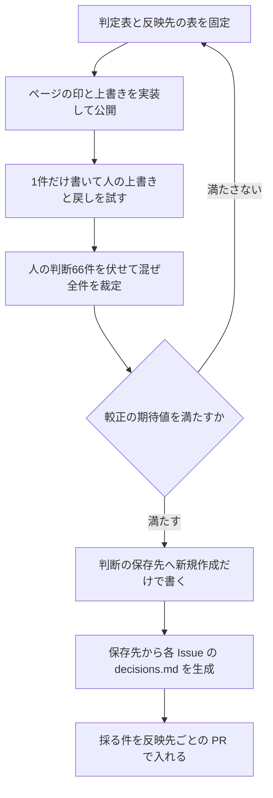

# 採否の裁定と反映の設計 (2026-11-15 のスナップショット)

この文書は決めた時点の記録で、継続して更新しない。判定表と反映先の表の canonical は、裁定を回す道具に移した時点でそちらへ移る。

## 決めたこと (2026-11-15 の利用者の裁定)

- 採否は Claude が裁定して反映する。利用者はときどき CLAUDE.md と rules を目で見て調整する
- 裁定は厳しめにする。採るには積極的な証拠が要り、迷いは採らない側へ倒す
- 知見は3段に分ける。行動を変える判定は規範の段 (CLAUDE.md・rules・名指しされた references) へ、道具の事実は参照の段 (道具ごとの参照ファイル) へ置く。どちらにも入らないものは台帳 (非公開) に裁定と理由つきで残し、追跡下へは入れない

## 母集団

- 台帳 Version 9 の1017件。人の判断は66件 (採る61・採らない3・保留2)、Claude が裁定するのは残りの951件
- 951件の内訳: ISSUE-134 が515件 (42節)、ISSUE-133 が259件、ISSUE-88 が124件、ISSUE-132 が28件、ほかの Issue が25件

## 裁定の判定表

上から順に当て、最初に当たった行で決める。採否の記号は判断の保存先と `<ID>-decisions.md` に書く。

| 順 | 条件 | 採否 | 記号と添えるもの |
| --- | --- | --- | --- |
| 1 | 人の判断がある | 触らない | なし |
| 2 | 主張が誤っていると一次資料で確かめた | 採らない | R7 誤り (確かめた資料) |
| 3 | 既存の規範が同じ判定を持つ | 採らない | R1 既存の規範で足りる (場所と逐語の引用。機械で照合する) |
| 4 | 同じ道具を使う別のリポジトリでは起きない | 採らない | R2 出所のリポジトリに固有 |
| 5 | 前提の版で起きた事象で、今の版では起きないという証拠が手元にある | 採らない | R3 前提が古い (変更履歴か自分の実行) |
| 6 | 道具が自分でエラーを出し、その文面か道具の文書から手当てが自明 | 採らない | R5 自分で分かる失敗 |
| 7 | 版に依存し、版の記録が無く、届いた報告が1件 | 採らない | R6 古びる見込み |
| 8 | 同じ束の別の件と同じ知見 | 統合 | M 代表の件の ID |
| 9 | 決めるのに利用者の裁定が要る (MUST GLOBAL の射程を変える、渡した裁定の一覧と食い違う) | 保留 | H1 利用者の裁定 (何を決めれば解けるか) |
| 10 | 未決の open な Issue のタスクの中身にあたる | 保留 | H3 Issue の結論待ち (open な Issue の ID) |
| 11 | 反映が第三者の上流への投稿でしかできない | 保留 | H4 外への投稿 |
| 12 | 推測だけで、主張の真偽で採否が変わり、安く測れない | 保留 | H5 実測待ち (何を測れば解けるか) |
| 13 | 散文ではなく検査 (lint や ast-grep の規則) にできる | 保留 | H6 検査の候補 (どの検査か) |
| 14 | 下の「採る条件」を満たす | 採る | 段 (規範 / 参照)、置くファイルと節、差分だけなら D |
| 15 | どれにも当たらない | 採らない | R4 採る条件を満たさない (欠けた条件) |

### 採る条件

次の3つを全部、件の原文から示せること。

- トリガ: 次のセッションが、自分がその場面にいると気づける目印がある (触るファイル、打つコマンド、出る症状)
- 機序か手当て: 道具のエラーや文書から自明でない
- 沈黙: 失敗が黙って起きる (緑のまま、0件のまま、別の経路で成立したまま)

届いた報告が2件以上の件は、沈黙の条件を欠いても、トリガと機序か手当てがあれば採る。届いた報告の数は優先の目安にとどめ、1件であること自体は採らない理由にしない。

### 一部が既にある件

既存の規範が判定の一部を持つ件 (見立てで既存の規範が「一部ある」とされたもの) は、既存の項目へ足す差分だけを採る (記号 D)。新しく足すのがトリガ・機序・手当てのどれかを書く。差分が無ければ行3か行15で採らない。

### 常時層の候補

CLAUDE.md の常時層が置き場にふさわしい件は、裁定の段では「常時層の候補」の印を付けるだけにする。予算に収まるかは件ごとには決まらないので、裁定の後に候補を1回で順位付けし、予算 (canonical は config-guard の `instruction_budget`) の内側に入る分だけを採る。参照の段を指す1行を先に確保する。残りは references へ置くか、まとめて1件の H2 (予算の引き上げ) として利用者に相談する。

## 反映先の表

各行は3つの条件を満たす。トリガから届くこと、この goal の中で Claude が書けること、容量があること。

| 段 | 反映先 | 置くもの | 届く経路 |
| --- | --- | --- | --- |
| 規範 | CLAUDE.md の常時層 | 全リポジトリのどの作業でも効く判定の骨格 | session_start |
| 規範 | 既存の paths 付き rules | その paths のファイルを読む作業で効く判定 | Read の発火 |
| 規範 | 既存の references | CLAUDE.md か rules のカテゴリが名指しする references の、既存の項目への差分 | 名指しした規範 |
| 規範 | 新しい paths 付き rules と references の組 | 採る件が5件以上ある技術領域の判定。rules の本文は「症状 → references の節」の3〜5行だけにする | Read の発火 |
| 参照 | 道具ごとの参照ファイル (`references/tool-<道具>.md`) | 道具の事実と手当て | CLAUDE.md の常時層の1行が、どの場面でどのファイルを引くかを書く |
| 規範 | agentic-coding-tools の skill | 配っている skill の手順の欠陥と追加 | skill の起動。委譲の手順で入れ、dotfiles の apm の pin を揃える |
| 規範 | dotfiles 自身 | dotfiles の設定・スクリプト・検査に効くもの | dotfiles の該当箇所 |

- 第三者の上流の skill や組み込みの skill の欠陥は、使う側の書き方で避けられるならその書き方を参照の段か規範の段へ採る。上流を直すほかに手当てが無いものだけを行11の H4 にする
- references のファイルは1枚20KBを上限とし、超えるときはトリガで分ける
- 名指しの無い references は届かないので、どの references も CLAUDE.md か rules に名指しされていることを config-guard で検査する (反映の段で足す)

### 版に依存する知見

- 版に依存する件は参照の段か references に置き、rules と CLAUDE.md へは置かない
- 本文に「報告 YYYY-MM-DD、<道具> <版>」の形で添える。版が分からなければ「版は未記録」と書く。版を推測で埋めない
- 版の記録が無く届いた報告が1件の件は、行7で採らない

### 技術領域の組

ISSUE-134 の節をファイルの目印で束ねた。新しい rules を足すのは、組の中で採る件が5件以上あり、版に依存しない件を含むときだけにする。下回る組は参照の段の道具ごとの参照ファイルへ置く。

| 組 | ISSUE-134 の節 | 目印 (paths) |
| --- | --- | --- |
| Node と pnpm | pnpm、Biome、wrangler と Vite と Vitest (Vite と Vitest の側)、Node と Web の API (Node の側) | `package.json`・`pnpm-lock.yaml`・`pnpm-workspace.yaml`・`biome.json`・`biome.jsonc` |
| Cloudflare | Cloudflare の6節、wrangler と Vite と Vitest (wrangler の側) | `wrangler.toml`・`wrangler.json`・`wrangler.jsonc` |
| GitHub Actions | GitHub Actions と Node の版、CI のコンテナと digest 固定 | `.github/workflows/*.yml`・`.github/workflows/*.yaml`・`action.yml`・`action.yaml` |
| フロントエンド | Playwright でスタイルと配置を測る、ブラウザでレスポンシブと文字サイズを測る、SVG の2節、Web Share API、Node と Web の API (Web の側) | 既存の frontend-practices.md |
| テストと E2E | React と E2E (Playwright)、Playwright Test Agents とブラウザの MCP | 既存の testing-practices.md |
| Rust | Rust と依存の脆弱性、GPUI | 既存の rust-practices.md |
| PostgreSQL と Supabase | PostgreSQL、Supabase CLI と外部サービスの CLI (Supabase の側) | `*.sql`・`supabase/config.toml` |
| Apple | iOS | `*.swift`・`project.pbxproj` |
| コンテナ | コンテナイメージの配信と trust store | `Dockerfile`・`Containerfile`・`compose.yml`・`compose.yaml`・`docker-compose.yml`・`docker-compose.yaml` |
| 開発ツールの設定 | mise の lock、pre-commit と lefthook | `mise.toml`・`.mise.toml`・`.pre-commit-config.yaml`・`lefthook.yml`・`lefthook.yaml` |
| Windows | Windows と MSI、Tauri と WebView2 | `*.wxs`・`tauri.conf.json` |
| Python | Python | `*.py`・`pyproject.toml` |

- 目印の paths は glob の形が既存の pin と同じもの (`**/<ファイル名>`・`**/*.<拡張子>`) を使う。ディレクトリと拡張子を組む形 (`**/.github/workflows/*.yml`) は実プローブで発火を確かめてから入れる
- 目印の無いもの (GitHub の CLI、その他のツール、外部サービスの CLI、macOS の3節、CodeSandbox、Quint、地理データ、LLM を組み込む機能、正規表現の計算量、Vercel) と、Claude Code の harness の挙動 (ISSUE-133 の hook と委譲・auto mode と権限・/goal の節) は、道具ごとの参照ファイルへ置く。Claude Code の挙動は1枚にまとめる

## 手順

### 裁定

- 件は ID の範囲ではなく、Issue の節の束で渡す
- 裁定する agent には、件の原文・Issue・節・届いた報告の数・追記の日だけを渡す。下ごしらえの見立て (推奨・理由・置き場の案) は渡さない。渡すと、測っているのが判定表ではなく見立てになる
- 渡すもの: この判定表と反映先の表、既存の規範の層 (CLAUDE.md・rules・references・配っている skill)、利用者の裁定の一覧 (メモリの feedback と、Issue の「決めたこと」の節)
- 返す欄は、件の ID、束の ID、採否、判定表の行と記号、添えるもの、採る件は段と置くファイルと節、短い根拠
- R1 の引用は `knowledge_ledger.verify.quote_in_file` で照合し、外れた件は裁定し直す。H3 の Issue の ID は open な Issue に実在することを照合する
- 951件の ID の集合と、返った ID の集合が一致することを機械で確かめる

### 較正

期待値は裁定の前に固定する。

- 人が「採る」とした61件 (正の対照): 43件以上 (7割) を「採る」とする。判定表は人より厳しいので満点を期待せず、食い違いは全件を読む
- 見立てで既存の規範に「ある」とされた件 (負の対照): 951件の中にある分の8割以上を、R1・R4・R5 のどれかで採らない
- 全体の採る件数: 951件のうち250件以下
- 人が「保留」「採らない」とした5件は数が少ないので期待値を置かず、食い違いを読むだけにする
- 一致の度合い: 2つの束を、件の順を入れ替えて別の agent にもう一度裁定させ、採否の一致率を出す。食い違った件は3体目に裁定させる
- 期待値を外したときは、正の対照の半分 (ID の順で奇数番目) だけを見て判定表を直し、残りの半分で測り直す

### 判断の保存先への書き込み

- 文書の形は `{decision, note: "", decidedAt, seenReports, decidedBy: "claude", claudeRule, claudeReason, claudeDest, updatedAt}`。Claude の理由は人のメモ (`note`) と別の欄に置き、人がメモを書いても消えない
- `seenReports` は書く時点の届いた報告の数で、これが無いと追記のある件が見直しの一覧に出る
- 書き込みは新規作成だけにする (`if_version` を付けない)。途中で人が判断した件は上書きされず、書き込みが失敗して止まる。1回の書き込みは50件までなので、書けた ID の集合から続きを再開できる形で回す
- 人の判断の集合は書く直前に読み直し、書く前と後で ID ごとのハッシュを比べる

### ページ

- `decidedBy` が `claude` の判断に印を出し、判断した側で絞り込める
- 人が判断のボタンか「このままでよい」を押したときは `decidedBy: "human"` を書く。Claude の判断を人が押し直すと印が消える
- Claude の判断は既定の一覧に出さない。ただし利用者の裁定が要る保留 (H1・H2) は既定の一覧に出す
- Claude が判断した件に後から報告が追記されたときは、人の見直しの一覧ではなく、次の仕分けで Claude が裁定し直す
- 保存先から読んだ Claude の欄 (`claudeRule`・`claudeReason`・`claudeDest`) はカードに出し、書き込みの経路で落とさない

### Issue への記録

- 各 Issue のディレクトリに `<ID>-decisions.md` を置く。`issue.md` には書かない。台帳の差分抽出は `issue.md` だけを読み、節の見出しや `- INS-n の` の箇条や `| INS-n |` の表の行を拾うので、`issue.md` に書くと照合が壊れる
- `<ID>-decisions.md` は判断の保存先の写しを道具で生成し、手で直さない。先頭に写した日を書く
- 1件1行で、件の ID、箇条の冒頭 (K 系の ID はリポジトリの中に定義が無いので、Issue の箇条の1行目の冒頭を添える)、採否、判断した側、記号、反映先を書く。理由の文面は判断の保存先が持ち、追跡下には書かない

### 反映

- 束を1つの項目へまとめて入れ、件ごとに項目を立てない
- 追跡下へ入れる文面は、出所を落として一般化し、PUBLIC の漏洩スイープを通す
- PR は反映先ごとに、1本あたり20〜40件に収める
- 入れたあとで、採った文言を references と rules から検索し、重複を見つける
