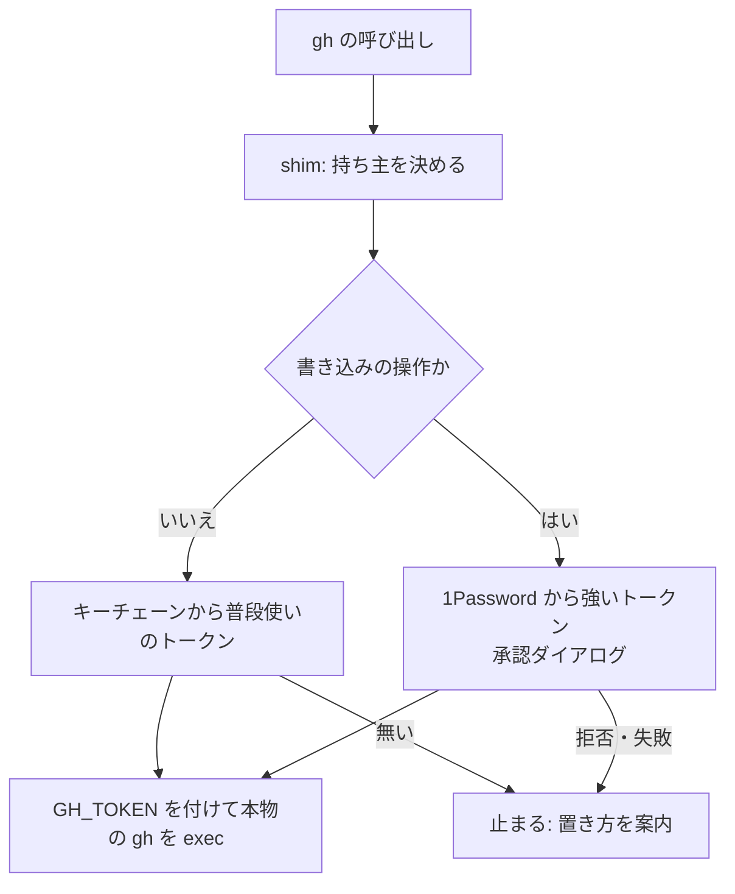

# ISSUE-147 設計: gh のトークンを持ち主と操作で選ぶ shim

2026-11-22 時点のスナップショット。背景と決定の経緯は issue.md が持つ。

## 意図

開発機で動く悪性のプロセス(悪性の版に入れ替わった開発依存など)が、確認なしに使える GitHub の権限を「読み取りと PR / Issue の書き込み」までに縮める。タグの作成、push、merge、release、ruleset と Environment の変更は、人の承認なしには通らないようにする。

## ゴール

- gh を呼ぶたびに、対象リポジトリの持ち主に合った fine-grained のトークンが自動で選ばれる。呼び手(人と Claude)は何も指定しない
- 書き込みが要る操作だけ、1Password の承認を経て強いトークンへ切り替わる
- 普段使いのトークンで通らない操作は、403 で止まる(安全側に倒れる)
- 別のリポジトリの構成検査(gh の既定のトークンで GET する)が、普段使いのトークンで読める

## 守りの境界

shim の書き込みの判定は安全の境界ではなく、使い勝手のためにある。普段使いのトークンはキーチェーンから承認なしで読めるので、悪性のプロセスは shim を通らずに直接使える。境界を決めるのは、普段使いのトークンに付けた権限そのものになる。

- 「判定から漏れた書き込みは 403 で止まる」が成り立つのは、普段使いの権限で届かない操作に限る
- PR / Issue の write だけで届く間接の書き込みは、承認なしに通りうる。例: コメントで Dependabot に merge させる、approve で auto-merge を完了させる、コメントやラベルで動く workflow を起こす(どれも未実測)
- これは残す(ユーザーの決定、2026-11-22)。実測し、通るものはリポジトリ側の設定で塞ぐ。タスクは「移行の順序」にある

## 非ゴール

- 同じユーザーのプロセスから普段使いのトークンを守ること。普段使いのトークンは、漏れても「守りの境界」の範囲しか持たない前提で、承認なしに置く
- 強いトークンの承認に、どのプロセスが要求したかを表示すること。1Password のダイアログは呼び手を区別しない。心当たりの無い承認を通さないことが最後の防衛線になる
- git の push / fetch。SSH で 1Password の agent が扱う(済み)
- トークンの期限切れを事前に知らせる仕組み。期限が切れると 401 で止まるので気づける。必要になったら別 Issue にする
- 他人のリポジトリへの書き込み(upstream への Issue や fork からの PR)。fine-grained は持ち主を1つしか選べないので、OAuth のトークンを外すと gh からは書けなくなる。必要なときは画面で行う

## 受け入れる残りのリスク

- 強いトークンは、承認した gh の子プロセス(git、hook、pager、`$EDITOR`、extension)にも環境変数で渡る。その木の中で入れ子に呼ばれた gh は、`GH_TOKEN` をそのまま通す規則によって、承認なしで同じトークンを使う
- `op read` が呼ぶたびに承認を求めることは、Claude の Bash で実測しただけ。対話のターミナルでは、承認がしばらく効き続けるかもしれない。実装後に実物で測り、結果をこの節に書き足す

## アンチゴール

- 普段使いのトークンに Contents / Workflows / Administration の write が入ること
- 強いトークンに Administration が入ること
- 判定に迷ったときに、強いトークンへ倒れること(承認の頻度が上がり、承認が習慣で通るようになる)
- shim の判定の誤りで、承認の後ろに置いたはずの書き込みが承認なしに通ること。普段使いの権限の範囲(PR / Issue の write)は、承認なしで通るのが設計どおり

## 承認を得た方針

- 案 B: PATH の先頭に gh の shim を置き、持ち主と操作から使うトークンを選んで、本物の gh を `GH_TOKEN` 付きで exec する
- 採らなかった案
  - 案 A(呼び手が `GH_ELEVATE=1` で明示して昇格する): 呼び手が毎回判断する必要がある
  - 案 C(リポジトリごとの設定で `GH_TOKEN` を決める): リポジトリごとに配線が要り、別の持ち主を指す `gh api` で外れる
- トークンは持ち主ごとに2本(普段使いと強いもの)。どちらも fine-grained

## 全体の流れ

## 持ち主の決め方

上から順に見て、最初に決まったものを使う。

| 順 | 手がかり | 例 |
|---|---|---|
| 1 | `-R` / `--repo` の値(`OWNER/REPO`、`HOST/OWNER/REPO`、URL) | `gh pr view 1 -R acme/web` |
| 2 | `gh api` のパスの先頭が `repos/OWNER/`、`orgs/OWNER`、`users/OWNER` | `gh api repos/acme/web/rulesets` |
| 2' | 位置引数の `OWNER/REPO` または github.com の URL(`repo view/clone/create/fork`、`pr`・`issue` の URL 指定など) | `gh repo view acme/web`、`gh pr merge https://github.com/acme/web/pull/3` |
| 3 | 環境変数 `GH_REPO` | |
| 4 | 今いるディレクトリの git の `origin` の URL(github.com のものだけ) | |
| 5 | 決まらなければ既定の持ち主(個人アカウント) | `gh api user`、`gh search` |

- 判定はトークンを選ぶためだけに使い、gh へ渡す引数は書き換えない
- 決まった持ち主のトークンが設定に無い(他人のリポジトリなど)ときは、既定の持ち主の普段使いのトークンを使う。公開リポジトリの読み取りはそれで通る。設定には、トークンを持つ持ち主の一覧を置く
- 4 で `origin` が無いリポジトリは 5 に落ちる。gh 自身は `gh repo set-default` や他の remote も見るが、shim はそこまで追わない。外れたら 403 / 404 で止まるだけで、強い側には倒れない
- 持ち主の名前は GitHub の規則(英数字とハイフン)で検証してから、キーチェーンの検索と 1Password の参照に使う。参照の文字列を外部入力から組み立てるため

## 書き込みの判定

書き込みと判定したものだけ強いトークンを使う。それ以外は全部、普段使いのトークンになる。一覧に漏れた書き込みは、普段使いのトークンで実行されて 403 で止まる。

| サブコマンド | 書き込みとみなす条件 |
|---|---|
| `pr` | `merge` |
| `release` | `create` `edit` `delete` `upload` `delete-asset` |
| `repo` | `sync` |
| `workflow` | `run` `enable` `disable` |
| `run` | `rerun` `cancel` `delete` |
| `secret` `variable` | `set` `delete` |
| `ruleset` | なし(読み取りだけのサブコマンド) |
| `cache` | `delete` |
| `api` | `-X` / `--method` が GET と HEAD 以外。`-X` が無くても `-f` / `-F` / `--field` / `--raw-field` / `--input` があれば書き込み(gh はこの場合 POST を既定にする) |
| `api graphql` | `mutation` を含むクエリ(`-f query=` の値、または `--input` で渡したもの) |

- `pr create`、`issue` 全般、`pr comment` / `review` / `edit` / `close`、`label` は、普段使いのトークンの PR / Issue の write で通るので昇格しない
- `api` の GET でも `-f` を付けると POST になる。shim は gh と同じ規則で判定する
- `api graphql` で `--input` からクエリを読む場合は、shim が中身を読めない(標準入力は1回しか読めない)。そのときは書き込みとみなす

強いトークンでも通らない操作(Administration の write が要るもの)は、昇格させずに止める。承認しても必ず 403 になるので、意味のない承認を習慣にしないため。止めるときは、画面での操作を案内する。

| サブコマンド | 対象 |
|---|---|
| `repo` | `create` `delete` `edit` `rename` `archive` `unarchive` `fork` `deploy-key add/delete` `autolink create/delete` |

トークンが要らない操作は、トークンを選ばずにそのまま通す: `--version`、`help`、`completion`、`auth` 全般。移行の途中で `gh auth logout` を打てるようにするため。

## トークンの置き場所と権限

| 段 | 置き場所 | 読み方 | 承認 |
|---|---|---|---|
| 普段使い | macOS のキーチェーン。service `gh-token-shim`、account `<owner>:read` | `security find-generic-password -s gh-token-shim -a <owner>:read -w` | なし |
| 強い | 1Password。参照は `op://<vault>/gh-write-<owner>/credential` | `op read` | 呼ぶたびに出る(実測) |

- vault の名前、既定の持ち主、トークンを持つ持ち主の一覧は、マシンローカルの設定ファイル(`~/.config/gh-token-shim/config`、追跡しない)に置く。PUBLIC のリポジトリに、org の名前と vault の名前を持ち込まないため。追跡下には例(`config.example`)だけを置く
- 普段使いの権限(fine-grained): Metadata / Contents / Actions / Administration / Environments / Secrets / Dependabot alerts / Commit statuses を read、Pull requests / Issues を write
- 強い権限(fine-grained): 普段使いの権限に加えて、Contents / Workflows / Actions / Secrets / Variables の write。Administration は read のまま
- org の持ち主で fine-grained のトークンが許可されていなければ発行できない。発行の手順の中で確かめる

## 失敗の扱い

- 普段使いのトークンがキーチェーンに無い: 止まる。置き方のコマンドを英語で stderr に出す。旧来の keyring のトークンへは落ちない
- 強いトークンを読めない(承認の拒否、op の失敗、参照が無い): 止まる。普段使いのトークンで続行はしない
- 本物の gh が見つからない、または shim 自身に解決される: 止まる(apm-guard と同じ守り)
- 呼び手が `GH_TOKEN` / `GITHUB_TOKEN` を既に設定している: shim は選ばずにそのまま通す。CI と、意図して上書きする場面のため
- shim を外して本物の gh を叩く逃げ道は残す(PATH から外せばよい)。バイパス用の環境変数は作らない

## 配線

apm-guard と同じ形にする。

- 本体は `scripts/gh-token-shim/gh` と `lib.sh`
- `bootstrap.sh` の `SYMLINK_PAIRS` が `~/.local/libexec/gh-token-shim/` へ張る
- `.zshrc` で PATH の先頭に足す。Claude Code の Bash は起動元のシェルの PATH を継承するので、shell snapshot の制約は受けない
- shellcheck の対象(CI と pre-commit の files パターン)に、拡張子の無い `gh` を足す

## テスト

- bats で、判定の表(持ち主と書き込み)をそのまま仕様として書く。偽の `gh` / `security` / `op` を PATH に置き、選ばれたトークンと引数がそのまま渡ることを観測する
- 失敗の扱いの各行に1件ずつ置く。偽の `op` が非 0 を返したときに、普段使いのトークンで続行しないことも pin する
- 実物の結線は、実装後に一度通しで確かめる(読み取りの gh、昇格する gh、承認の拒否)

## 移行の順序

1. shim を入れる(この時点ではトークンが無いので、置き方の案内で止まる)
2. 持ち主ごとにトークンを発行して置く(ユーザーの操作)
3. OAuth のトークンを外す前に、ほかの使い手を棚卸しする。shim を通らない文脈(launchd、Raycast)で gh を呼ぶもの、`gh auth token` を読むもの(mise、apm の private の依存など)
4. gh の OAuth のトークンを `gh auth logout` で外し、GitHub の Authorized OAuth Apps から許可を取り消す
5. 構成検査を実物にかけ、普段使いのトークンで読めることを確かめる
6. 「守りの境界」の間接の書き込みを、普段使いのトークンで実測する。各リポジトリの workflow から、コメント・ラベル・review で起動するものを棚卸しする。通るものはリポジトリ側の設定で塞ぐ
7. 対話のターミナルで、`op read` の承認がどのくらい続けて効くかを測る

git の HTTPS の経路は、すでに塞がっている(2026-11-22 実測)。gh の github.com のホストの設定は `git_protocol: ssh` で、キーチェーンに github.com の HTTPS の認証情報は無い。

## ビルダーに任せること

- 書き込みの表の細部(gh の版で増えたサブコマンドへの追従)。漏れても安全側に倒れる
- 停止時のメッセージの文言
- 設定ファイルの書式(shell の `KEY=VALUE` を source せず、行で読む形を推奨)
