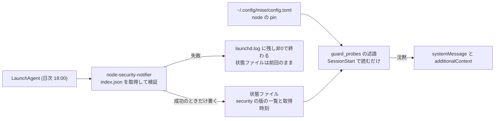

# ISSUE-131 spec: node の security リリースを pin と比べてセッション開始時に告げる

2026-10-22 時点のスナップショット。挙動の canonical はコードとテストで、この文書は書いた時点の意図を残す。

## 決めたこと (ユーザー裁定 2026-10-22)

- 経路: 日次のジョブが判定の元を取ってきて状態ファイルへ書き、SessionStart のプローブ (guard-health) がそのファイルと pin を読んで告げる。プローブは通信しない
- 判定の元: `https://nodejs.org/dist/index.json` の `security: true`。ブログのフィードと既読集合は外す
- macOS のバナー通知は外す。告げる経路はセッション開始時の1本にする
- 取得が止まっていると告げる閾値は3日

## 構成

比較をプローブの側に置くのは、pin を上げた直後に古い判定が残って誤報になるのを避けるため。日次のジョブは pin を読まない。

## 日次のジョブが失敗として扱うもの

空の一覧や形の崩れた要素を「該当なし」にしない。どれも状態ファイルを上書きせずに非0で終わる。

| 入力 | 扱い |
| --- | --- |
| 取得の失敗 (DNS、タイムアウト、HTTP エラー) | 失敗 |
| JSON として読めない | 失敗 |
| 最上位がリストでない、または空のリスト | 失敗 |
| 要素の `version` が `v<数>.<数>.<数>` でない | 失敗 |
| 要素の `security` が bool でない (欠けている場合を含む) | 失敗 |
| `security: true` が1件も無い | 失敗 (起こらないはずの形で、検証の側の壊れを疑う) |
| 上のどれにも当たらない | 成功。状態ファイルを書く |

## プローブのデシジョンテーブル

上から順に評価し、当たったものを沈黙の理由として集める。古さと遅れは両方当たりうるので、両方を1通にまとめて告げる。

| 条件 | 結果 |
| --- | --- |
| mise の設定が読めない、`[tools]` に node が無い、pin が `<数>.<数>.<数>` でない | 沈黙。pin を読めないと告げる |
| 状態ファイルが無い | 沈黙。まだ一度も判定していない (LaunchAgent が未導入か未実行) と告げる |
| 状態ファイルの形が崩れている | 沈黙。壊れていると告げる |
| 取得時刻が今から3日より前 | 沈黙。判定が止まっていると告げ、ログの場所を示す |
| pin と同じメジャーで pin より新しい security の版がある | 沈黙。その版を列挙し、pin の場所を示す |
| どれにも当たらない | 健全 (何も出さない) |

時刻は epoch 秒どうしで比べ、タイムゾーンを持ち込まない。

## 確かめ方

- 日次のジョブとプローブはそれぞれ単体テストで上の2表を pin する
- 実際の消費者の側で確かめる: guard-health を別プロセスで起動し、旧 pin (24.18.0) の設定と実データ由来の状態ファイルを与えて告知が出ること、現在の pin では何も出ないことを見る
- 実データで日次のジョブを一度走らせ、状態ファイルが書かれることを見る
