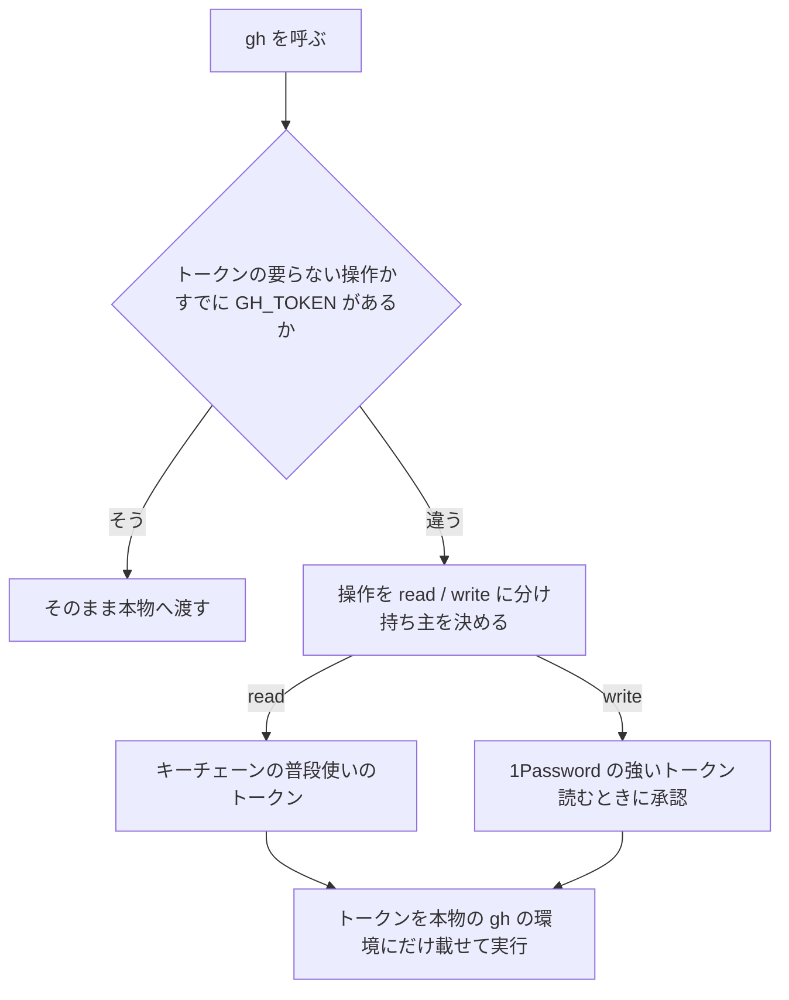

# gh-token-shim

PATH の先頭に置く `gh` の shim。リポジトリの持ち主ごとに fine-grained personal access token を選んで本物の `gh` へ渡し、書き込みのときだけ 1Password の承認を通して強いトークンへ昇格する。

この README は、使う人が「なぜこうなっているか」と「どう動くか」を掴むための入口。設計の意図と決定は ISSUE-147 (`docs/issues/ISSUE-147_*/`) の spec と issue.md、細かい判定はコードとテストが正本で、ここでは写さずに参照する。

## なぜ替えたか

`gh auth login` が作る OAuth のトークンは、ログインしたユーザーが触れる全部のリポジトリに対して、push・タグの作成・ruleset や Environment の変更までを確認なしで行える。開発機で動くツールや依存パッケージが悪性の版に入れ替わると、そのトークン1つで本番へ届く変更を人の承認なしに入れられた。

そこで、持ち主ごとに権限を絞った fine-grained のトークンを2本ずつ持つ形にした。

- 普段使いのトークンは読み取りが中心で、PR と Issue の書き込みだけを持つ。承認なしで使える
- 強いトークンは書き込みが要る操作のためのもので、1Password から読むときに承認が出る (Claude の Bash からは毎回出た。対話のターミナルで承認がどのくらい続けて効くかは未測定)。Administration の write はどちらにも付けないので、承認を通しても ruleset や Environment は変えられない

## 守れる範囲

shim の read と write の判定は使い勝手のためにあり、守りの境界ではない。境界を決めるのは、普段使いのトークンに付けた権限そのもの。

- 普段使いのトークンはキーチェーンから承認なしで読めるので、悪性のプロセスは shim を通らずに直接使える。漏れても、その権限で届く範囲に収まる前提で置いている
- 判定から漏れた書き込みが403で止まるのは、普段使いの権限で届かない操作だけ
- PR と Issue の write だけで届く間接の書き込みは、承認なしに通りうる。例はコメントで Dependabot にマージさせる、approve で auto-merge を完了させる、コメントやラベルで動く workflow を起こす。これは受け入れたリスクで、実測とリポジトリ側での塞ぎ方は ISSUE-147 のタスクにある

## どう動くか

- 手順の順序と分岐の正本は `gh` の「手順 N」のコメントで、その順序を `scripts/tests/gh-token-shim.bats` が固定している。図はその粗い要約で、設定の読み込み、管理の操作の拒否、stdin の graphql の読み直しを省いている
- read と write の分け方の正本は `lib.sh` の分類の関数。どの操作が承認で止まるかもここで決まる
- 持ち主の決め方と、決められないときに書き込みを止めるか既定の持ち主へ落とすかの正本は `gh` の手順 5。リポジトリの外や origin の無いリポジトリでは、読み書きとも既定の持ち主になる
- 強いトークンを読めないとき (承認を拒否したときを含む) は手順 7 で止まり、普段使いのトークンでは続けない
- `gh auth` はトークンを付けずに本物へ渡す。shim はトークンを外へ配らない

## 置き場所と設定

- 設定は `~/.config/gh-token-shim/config` で、追跡しない。書式と各キーの意味は `config.example` が持つ
- 2本とも 1Password が正本。普段使いのトークンはキーチェーンへ写し、shim はそこから読む。`op read` は承認を出すので、承認なしで使う普段使いのトークンは 1Password から読まない。作り直すときは 1Password を先に更新して写し直す。キーチェーンの名前の付け方は `config.example` と `gh` の `KEYCHAIN_SERVICE` が持ち、未登録のときは shim のエラーが登録のコマンドを出す
- 強いトークンの 1Password の項目名の形は、設定の `write_item=` で決める
- shim 本体は `bootstrap.sh` が symlink で配り、`home/.zshrc` が PATH の先頭へ足す

## 困ったとき

| 症状 | 原因と対処 |
|---|---|
| gh が未ログインで落ちる | shim を配る前から動いているシェルやセッションは、起動時に写した古い PATH を持つ。新しい zsh から起動し直すか、`zsh -i -c '<コマンド>'` で包む |
| 承認ダイアログで止まる | 書き込みに分類した操作は、強いトークンを読むときに承認を求める。拒否すると止まる |
| 「Could not resolve to a Repository」 | 設定に無い持ち主の private のリポジトリを、既定の持ち主のトークンで読んだ。持ち主を設定に足す。リポジトリの外から別の持ち主を指すときは `-R` か `GH_REPO` で名指しする (graphql は本文の持ち主を読まないので `GH_REPO`) |
| 403 / Resource not accessible | そのトークンの権限で届かない。REST なら応答の `x-accepted-github-permissions` が要る権限を示す (GraphQL のエラーには付かない)。書き込みなのに shim が read に分類した操作なら、`lib.sh` の書き込みの表に足して昇格させる。下の「分かっている制限」も見る |
| どのトークンで通ったか分からない | `gh api -i user` の応答ヘッダで見分ける。fine-grained のトークンなら `github-authentication-token-expiration`、OAuth なら `x-oauth-scopes` が付く |

## 分かっている制限

GitHub の fine-grained のトークンが未対応のもの (GitHub のドキュメントの "Managing your personal access tokens"):

- 外部コラボレーターとして参加しているリポジトリには使えない。その org のメンバーになる必要がある
- Checks API を呼べない。private のリポジトリの check run (REST の `commits/<sha>/check-runs`) は読めないので、CI の結果は `gh run list` / `gh run view` で読む

shim の作りによるもの:

- `gh auth token` を読んでトークンを得る道具 (apm、Homebrew の GitHub API など) は、匿名のアクセスに落ちる
